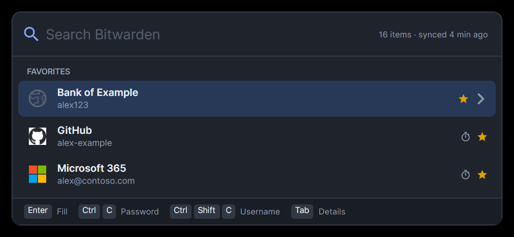
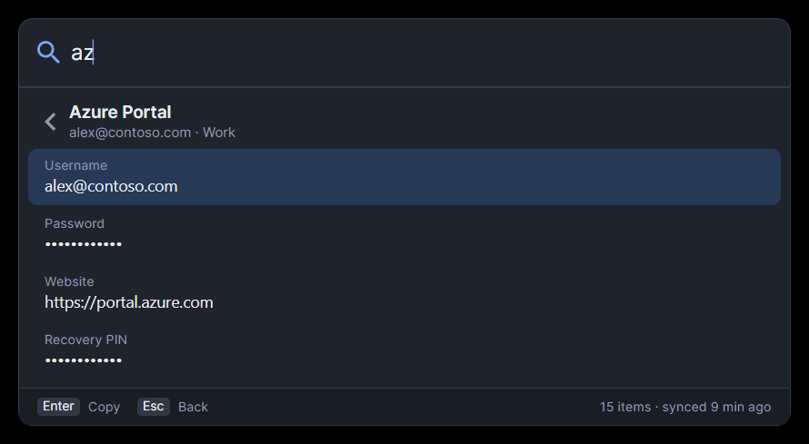

# Vaultbar

A 1Password-style **Quick Access** search bar for Bitwarden, on Windows, Linux and macOS.

Press **Ctrl+Shift+Space** (macOS: **⌘⇧Space**) anywhere, type a few letters, and fill or copy a credential
without leaving the app you are in.



- One self-contained executable per platform. It needs no .NET runtime, no Bitwarden CLI and no browser extension.
- Works on top of the **Bitwarden desktop app**. It reads the encrypted vault the desktop app already keeps on disk, and
  unlocks it with your master password, offline.
- Auto-types into the window you came from, like 1Password's Quick Access and Bitwarden's own browser autofill.

## How it compares to 1Password Quick Access

| 1Password Quick Access | Vaultbar |
| --- | --- |
| Global shortcut Ctrl+Shift+Space | Same (configurable) |
| Fuzzy search on title, username, website | Same, plus folder; ranking learns from what you use |
| Suggestions for the app/site in front | "Suggested for …" from the window title / app, then Favorites and Recently used |
| Enter fills into the previous app | Same: types `username ⇥ password`, then copies the one-time code |
| Ctrl+C / Ctrl+Shift+C / Ctrl+Alt+C copy password / username / code | Same (macOS ⌘C / ⌘⇧C / ⌘⌥C). Bitwarden's Ctrl+P / Ctrl+U / Ctrl+T also work |
| → shows item details | Tab or → |
| Clipboard cleared after use | After 30 s and on lock, only if it still holds what Vaultbar put there; hidden from Windows clipboard history/cloud, macOS concealed type, KDE password hint |
| Unlock with Windows Hello / Touch ID | Windows Hello on Windows; master password on Linux and macOS |

## Keys

| Key | Search list | Item details |
| --- | --- | --- |
| type | search | |
| ↑ ↓ PgUp PgDn | select | select field |
| Enter | logins: **auto-type**; notes: copy; others: details | copy field |
| Shift+Enter | auto-type password only | |
| Ctrl+Enter / Ctrl+O | open website | open website |
| Ctrl+C | copy password (card number, note, public key) | copy field |
| Ctrl+Shift+C | copy username (card code, private key) | |
| Ctrl+Alt+C / Ctrl+T | copy one-time code | |
| Ctrl+Shift+U | copy website | copy website |
| Ctrl+Shift+O | open in the Bitwarden web vault | open in the Bitwarden web vault |
| Tab / → | details | |
| Space | | reveal hidden field |
| Esc | clear search, then close | back |
| Ctrl+L | lock | lock |
| F1 / Ctrl+/ | keyboard shortcuts | keyboard shortcuts |

On macOS use ⌘ instead of Ctrl, and ⌥ for Alt. Items with **master password re-prompt** ask for Windows Hello (or the
master password) once per opening. On the unlock screen, Ctrl+H retries Windows Hello.



## Install

You need the **Bitwarden desktop app**, logged in once. Vaultbar reads its local data and picks up changes as soon as
the desktop app syncs.

Each one-liner downloads the latest release for your CPU and installs it for the current user, without admin rights or
prompts. It then turns on start-at-login and starts Vaultbar. Run the same line again to update.

**Windows** (PowerShell)

```powershell
irm https://raw.githubusercontent.com/byhofman/vaultbar/main/install/install.ps1 | iex
```

**Linux** (bash)

```bash
curl -fsSL https://raw.githubusercontent.com/byhofman/vaultbar/main/install/install.sh | bash
```

**macOS** (zsh)

```zsh
curl -fsSL https://raw.githubusercontent.com/byhofman/vaultbar/main/install/install-macos.sh | zsh
```

Then press **Ctrl+Shift+Space** (macOS: **⌘⇧Space**).

| | Windows | Linux | macOS |
| --- | --- | --- | --- |
| Installs to | `%LOCALAPPDATA%\Programs\Vaultbar\vaultbar.exe` | `~/.local/bin/vaultbar` | `/Applications/Vaultbar.app` (or `~/Applications`), CLI link in `~/.local/bin` |
| Also | Start-menu shortcut, adds itself to the user `PATH` | GNOME on Wayland: binds the shortcut | Clears the download quarantine, ad-hoc signs the app |

**Uninstall**

```powershell
& ([scriptblock]::Create((irm https://raw.githubusercontent.com/byhofman/vaultbar/main/install/install.ps1))) -Uninstall
```

```bash
curl -fsSL https://raw.githubusercontent.com/byhofman/vaultbar/main/install/install.sh | bash -s -- --uninstall
```

```zsh
curl -fsSL https://raw.githubusercontent.com/byhofman/vaultbar/main/install/install-macos.sh | zsh -s -- --uninstall
```

Uninstalling leaves your settings folder (see Configuration) in place.

**Options:** install a specific release with `-Version v0.1.0` (PowerShell) or `--version v0.1.0` (bash/zsh). To
install from an archive you already downloaded, use `-Archive <file>` or `--archive <file>`. The archives are
`vaultbar-<win|linux|osx>-<x64|arm64>.zip/.tar.gz` on the releases page. On macOS, `--dir <folder>` installs somewhere other than `/Applications`.

### Platform notes

- **Linux, X11:** Vaultbar registers Ctrl+Shift+Space itself. Auto-type works out of the box, including characters
  that aren't on your keyboard layout.
- **Linux, Wayland:** apps can't grab global shortcuts or type into other windows. On GNOME the installer binds the
  shortcut for you (`vaultbar shortcut`). On KDE Plasma, add one under System Settings › Keyboard › Shortcuts ›
  Add New › Command: `vaultbar toggle`. For auto-type, install `wtype` (wlroots/KDE) or `ydotool`. Without them,
  Enter copies the password instead.
- **Linux libraries:** Vaultbar needs the standard X11 client libraries (`libX11`, `libXtst`, `libICE`, `libSM`,
  `fontconfig`). Every desktop install has them, and the installer warns if one is missing.
- **macOS:** for auto-type, allow Vaultbar under **System Settings › Privacy & Security › Accessibility**; it asks the
  first time. Updating re-signs the app, which resets that permission.

## Command line

```
vaultbar              start (if needed) and open the search bar
vaultbar toggle       open/close the search bar of the running instance (for desktop shortcuts)
vaultbar background   start without opening (used by autostart)
vaultbar lock | quit
vaultbar autostart on|off
vaultbar shortcut     Linux/GNOME: bind the hotkey through GNOME settings
```

## Configuration

`config.json` lives in `%APPDATA%\vaultbar` (Windows), `~/.config/vaultbar` (Linux) or
`~/Library/Application Support/vaultbar` (macOS). It is created on first start. Restart Vaultbar after editing it.

| Setting | Default | |
| --- | --- | --- |
| `hotkey` | `Ctrl+Shift+Space` (`Cmd+Shift+Space` on macOS) | Modifiers `Ctrl`, `Shift`, `Alt`/`Option`, `Win`/`Super`/`Cmd` + `A`–`Z`, `0`–`9`, `F1`–`F24` (macOS `F1`–`F20`), `Space` |
| `lockAfterMinutes` | `null` | Idle lock. `null` follows the Bitwarden desktop vault timeout (numeric values; "on restart"/"never" mean no idle lock) |
| `lockOnSystemLock` | `true` | Lock when the session locks or the machine sleeps (Windows, macOS) |
| `clipboardClearSeconds` | `30` | `0` disables clearing |
| `autotypeSequence` | `{USERNAME}{TAB}{PASSWORD}` | Tokens: `{USERNAME}` `{PASSWORD}` `{TOTP}` `{TAB}` `{ENTER}` `{DELAY:ms}`. Without a username, the following `{TAB}` is skipped |
| `copyTotpAfterFill` | `true` | Copy the one-time code after auto-type, ready to paste on the next screen |
| `hideAfterCopy` | `true` | Close the bar after copying |
| `showFavicons` | `true` | Website icons from Bitwarden's icon service (also honours the desktop app's setting) |
| `dataPath` | `null` | Path to the desktop app's `data.json` if it is not in the standard place |
| `hideFromScreenCapture` | `true` | Keep the search bar out of screenshots, recordings and screen sharing (Windows, macOS) |
| `windowsHello` | `true` | Offer Windows Hello unlock after a master-password unlock. Turn it on or off later from the tray menu |

## How it works and security

- The Bitwarden desktop app keeps your vault on disk **encrypted** (`data.json` in its app-data folder; snap, flatpak
  and Mac App Store locations are detected too). Vaultbar derives your master key from your master password with the
  account's KDF (PBKDF2-SHA256 or Argon2id). It then unwraps the user key (HKDF-stretched master key, AES-256-CBC +
  HMAC-SHA256) and decrypts organisation and per-item keys. This is the same scheme the official clients use.
- It never talks to the Bitwarden server and never writes to the vault. The only network traffic is favicons, which you
  can turn off. Host names that only exist on a local network (IP addresses, `localhost`, `.local`, `.lan`,
  `.internal`, `.corp`, names without a dot) are never sent to the icon service.
- Names, usernames and websites are decrypted for search. **Passwords, codes, notes and hidden fields stay encrypted in
  memory** until you copy, fill or reveal them. Locking zeroes the keys.
- Locks on idle timeout, `vaultbar lock`, Ctrl+L, the tray menu, and (Windows, macOS) on session lock or sleep.
- Re-prompt items require Windows Hello or the master password again. A password only counts if it unwraps the key the
  vault is unlocked with.
- **Windows Hello:** after the first master-password unlock Vaultbar creates its own Windows Hello key. Its signature
  over a random challenge derives the AES-256-GCM key that encrypts the vault's user key on disk
  (`%LOCALAPPDATA%\vaultbar\quick-unlock.dat`, wrapped once more with DPAPI). Unlocking needs your face, fingerprint or
  PIN; if the stored key no longer matches the vault, Vaultbar deletes it and asks for the master password.
- Copied secrets are also cleared when Vaultbar locks or crashes. The search bar is hidden from screen capture.
- Opening a website only ever opens `http`/`https` addresses. Auto-type never types into the taskbar, desktop or Start.
- The KDF settings in `data.json` are checked against Bitwarden's own bounds before they are used.
- The single-instance channel is a named pipe / Unix socket restricted to the current user. It only carries commands
  (show/toggle/lock/quit), never secrets.
- Nothing secret is logged. The log (`vaultbar.log` in the cache folder) records errors only.

## Limitations

- **Requires the Bitwarden desktop app.** Changes made in the browser extension show up once the desktop app has synced.
- **No Touch ID or Linux biometrics yet.** Windows has its own Windows Hello unlock (see above); the desktop app's
  biometric unlock is bound to that app and cannot be shared.
- Screen-capture hiding is not available on Linux.
- Accounts without a master password (SSO with trusted devices or key connector) are not supported. Neither is the
  newer "v2" (COSE) key format; Vaultbar says so instead of failing silently.
- Organisation items are tested against a synthetic vault and the Bitwarden SDK's RSA test vectors, not yet against a real organisation vault. Items of provider-managed organisations are not decrypted; they count as failed and the rest of the vault opens.
- Archived and deleted items are not shown.
- Windows: auto-type cannot type into apps running as administrator unless Vaultbar does too (UIPI).
- macOS: tested on Apple Silicon with a synthetic vault. Typing into another app, the physical hotkey press, a real click on the menu bar icon and a real screen lock still need a manual check (VBR-7).
- macOS: another app using the same hotkey is not detected; the system lets both register it.

## Build and test

Requires the .NET 10 SDK.

```powershell
./build.ps1                       # all platforms into ./dist (zip / tar.gz, macOS as Vaultbar.app)
./build.ps1 -Runtime win-x64      # one platform
```

Pushing a `v*` tag builds all platforms on GitHub Actions and publishes them as a release (`.github/workflows/release.yml`).

```powershell
dotnet test                       # unit + vault round-trip tests
./tests/e2e-linux/run.ps1         # Linux/X11 end-to-end in an Ubuntu container (hotkey, unlock, auto-type, copy, CLI)
docker run --rm -v ${PWD}:/w ubuntu:24.04 bash /w/tests/install-test.sh   # installer install/update/uninstall (after ./build.ps1)
tests/e2e-macos/run.sh            # macOS end-to-end on the real backend: focus, keys, copy, locking, tray (no Accessibility needed)
tests/install-test-macos.sh dist/vaultbar-osx-arm64.tar.gz   # macOS installer install/update/uninstall (after ./build.ps1)
```

The tests build a synthetic, Bitwarden-shaped encrypted vault (`tests/Vaultbar.Tests/VaultFixture.cs`). They never touch
a real one, and the macOS scripts run in a throwaway `HOME`.

## License

MIT, see [LICENSE](LICENSE). Vaultbar is an independent project, not affiliated with or endorsed by Bitwarden Inc. or 1Password.
